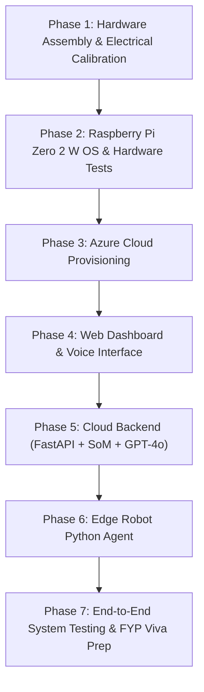

# FYP2 Step-by-Step Implementation Guide & Trade-Off Analysis

---

## 1. Trade-Off Analysis: Azure IoT Hub vs. FastAPI (Direct WebSocket / REST)

| Feature / Metric | Azure IoT Hub (MQTT / AMQP) | FastAPI Direct (WebSockets + REST) |
| :--- | :--- | :--- |
| **Architectural Complexity** | **High**: Requires Azure IoT SDK on Pi, SAS token generation, IoT Device Twin, and cloud routing triggers (Event Grid/Functions). | **Low to Moderate**: Clean Python code (`websockets` / `requests` / `httpx`). Easy to run and debug locally in VS Code. |
| **Real-Time Latency** | **Moderate (~300ms - 800ms)**: Messages traverse Pi -> IoT Hub -> Event Hub/ServiceBus -> Backend -> Dashboard. | **Ultra-Low (<100ms)**: Direct persistent bidirectional TCP socket between Pi, Backend, and Web Dashboard. |
| **Memory Footprint on Pi** | **Heavier**: Azure IoT Device SDK has multiple heavy dependencies and background threads (Pi Zero 2W has only 512MB RAM). | **Very Light**: Minimal RAM footprint using standard Python `asyncio` + `websockets`. |
| **Offline Buffering** | **Built-in**: Queues Cloud-to-Device (C2D) commands if Wi-Fi momentarily drops. | **Manual**: Must be coded into Python if offline queueing is needed. |
| **Enterprise FYP Appeal** | **High**: Demonstrates cloud IoT enterprise PaaS mastery in FYP thesis. | **High in Full-Stack**: Demonstrates high-performance API design, microservices, and async architecture. |
| **Cost / Free Tier** | Free F1 tier (8,000 messages/day limit). | Runs inside Azure App Service / Container Apps (covered under student / free credits). |

### Final Engineering Recommendation for FYP2
> [!TIP]
> **Use FastAPI with WebSockets as your primary backbone**:
> 1. It delivers the sub-second responsiveness needed for smooth live demonstration during FYP viva.
> 2. It avoids the RAM overhead of the Azure IoT C/Python SDK on the Raspberry Pi Zero 2 W (512MB RAM limit).
> 3. If your FYP rubrics specifically reward Azure IoT Hub usage, you can configure an **IoT Hub Telemetry Bridge**: the robot sends periodic health telemetry (battery voltage, ToF distance) to IoT Hub, while real-time camera streaming and immediate voice commands flow through the FastAPI WebSocket.

---

## 2. Step-by-Step Implementation Roadmap



---

### Phase 1: Hardware Assembly & Electrical Calibration

#### Step 1.1: Calibrate the LM2596 Buck Converter (MANDATORY SAFETY STEP)
> [!CAUTION]
> **DO NOT** connect the LM2596 to the Raspberry Pi Zero 2 W out of the box! The factory default potentiometer setting is often 12V or higher, which will **instantly destroy** your Raspberry Pi.
1. Connect your 2S 18650 battery pack (~7.4V - 8.4V) to the **IN+** and **IN-** terminals of the LM2596.
2. Set a Digital Multimeter (DMM) to DC Voltage mode and place probes on **OUT+** and **OUT-**.
3. Use a small flathead screwdriver to turn the brass trimmer potentiometer **counter-clockwise** (often 10–20 turns) until the multimeter reads **precisely 5.10V** (5.10V compensates for wire resistance under load).
4. Turn off the battery before proceeding.

#### Step 1.2: Mechanical & Electrical Assembly
1. Mount the two DC gear motors and rear ball caster onto the 2WD acrylic chassis.
2. Mount the L298N motor driver, LM2596 buck converter, and Raspberry Pi Zero 2 W using brass standoffs.
3. Wire the power distribution:
   - Battery (+) -> Power Switch -> L298N `12V` terminal **AND** LM2596 `IN+`.
   - Battery (-) -> L298N `GND` terminal **AND** LM2596 `IN-`.
   - LM2596 `OUT+` (5.1V) -> Raspberry Pi Physical Pin 2 (`5V`).
   - LM2596 `OUT-` (GND) -> Raspberry Pi Physical Pin 6 (`GND`).
   - Interconnect L298N `GND` to Raspberry Pi Pin 39 (Common Ground).
4. Connect L298N logic pins to Raspberry Pi:
   - `ENA` -> GPIO 12 (Pin 32)
   - `IN1` -> GPIO 17 (Pin 11)
   - `IN2` -> GPIO 27 (Pin 13)
   - `IN3` -> GPIO 22 (Pin 15)
   - `IN4` -> GPIO 23 (Pin 16)
   - `ENB` -> GPIO 13 (Pin 33)
5. Connect VL53L0X ToF Sensor:
   - `VIN` / `VCC` -> 3.3V (Pin 1)
   - `GND` -> GND (Pin 9)
   - `SDA` -> GPIO 2 (Pin 3)
   - `SCL` -> GPIO 3 (Pin 5)
6. Attach Raspberry Pi Camera Module v2 to the CSI connector using the 22-pin to 15-pin ribbon cable.

---

### Phase 2: Raspberry Pi Zero 2 W OS & Peripheral Testing

#### Step 2.1: Flash Raspberry Pi OS
1. Use **Raspberry Pi Imager** on your PC.
2. Choose OS: **Raspberry Pi OS (64-bit) Lite** (or with Desktop if preferred; Lite saves ~200MB RAM).
3. In OS Customisation settings (gear icon):
   - Set hostname (e.g. `wheelrobot`).
   - Enable SSH (with username and password).
   - Configure local Wi-Fi SSID and password.

#### Step 2.2: Enable Hardware Interfaces
SSH into your Pi via VS Code terminal:
```bash
sudo raspi-config
```
- Navigate to **Interface Options**:
  - Enable **I2C** (for VL53L0X)
  - Enable **Camera** (libcamera / picamera2)
- Update and install base packages:
```bash
sudo apt update && sudo apt upgrade -y
sudo apt install -y python3-pip python3-gpiozero python3-picamera2 i2c-tools python3-smbus
```

#### Step 2.3: Verify Sensors and Actuators
1. **Verify I2C Sensor**:
   ```bash
   i2cdetect -y 1
   ```
   *Expected output: Address `0x29` should appear (default address of VL53L0X).*
2. **Verify Camera**:
   ```bash
   libcamera-still -o test.jpg
   ```
   *Verify that `test.jpg` is captured successfully.*
3. **Verify Motors**:
   Create a quick test script (`test_motors.py`) with `gpiozero.Motor` to confirm left and right wheels turn forward, backward, and stop.

---

### Phase 3: Microsoft Azure Cloud Provisioning

Sign in to [Azure Portal](https://portal.azure.com):

1. **Resource Group**:
   - Create a resource group named `rg-fyp-wheelrobot` (Region: East US or Southeast Asia).
2. **Azure OpenAI Service**:
   - Create an Azure OpenAI resource.
   - In Azure AI Foundry / Azure OpenAI Studio, deploy model **`gpt-4o`** (Deployment name: `gpt-4o-robot`).
   - Save the **Endpoint** and **API Key**.
3. **Azure AI Speech Services**:
   - Create an **Azure Speech** resource.
   - Note the **Speech Key** and **Region** (e.g., `southeastasia`).
4. **Azure Blob Storage**:
   - Create a Storage Account (e.g., `strgwheelrobot`).
   - Create a container named `camera-frames` (Access level: Blob / Private with SAS tokens).
5. **Azure Container Apps or App Service**:
   - Plan a Linux Python 3.11 App Service (B1 Basic or Free F1) to host your FastAPI orchestrator.

---

### Phase 4: Web Dashboard & Voice Interface

Create a modern, responsive HTML5/JS dashboard:
1. **Camera Viewport**: Displays the live snapshot captured by the robot and the Set-of-Mark annotated image side-by-side or toggled.
2. **Voice Interface**:
   - Uses Web Audio API and Azure Speech SDK for JavaScript.
   - A glowing microphone button: click to record user command (e.g. *"Drive forward and stop at the blue door"*).
   - Transcribes speech directly in browser or streams audio to backend STT.
3. **Telemetry Panel**:
   - Real-time gauge for VL53L0X distance (in millimeters).
   - Robot state indicator: `IDLE`, `ANALYZING`, `NAVIGATING`, `EMERGENCY_STOP`.
4. **Manual Override Controls**:
   - On-screen directional buttons (Forward, Backward, Left, Right, Emergency Stop) for safety testing.

---

### Phase 5: Cloud Backend (FastAPI Orchestrator + SoM Engine)

Build a FastAPI application with the following endpoints:
1. `POST /api/upload-frame`: Receives the raw JPEG from the Raspberry Pi and stores it in Blob Storage.
2. `POST /api/process-som`:
   - Runs object detection (YOLOv8 / FastSAM) on the frame.
   - Draws labeled tags `[1]`, `[2]`, `[3]` onto detected obstacles and targets.
   - Returns the annotated image URL and list of detected labels.
3. `POST /api/reason-command`:
   - Sends the annotated image + user voice text + ToF sensor distance to Azure OpenAI (`gpt-4o`).
   - Enforces a strict JSON Schema response containing the navigation step sequence.
4. `WebSocket /ws/robot`:
   - Maintains continuous bi-directional communication with the Raspberry Pi.
   - Pushes motion instructions to the robot and receives distance telemetry at 10Hz.

---

### Phase 6: Edge Robot Python Agent

Write `robot_agent.py` on the Raspberry Pi Zero 2 W:
1. **Camera Worker**: Takes snapshot on demand using `picamera2` and compresses to JPEG.
2. **Sensor Worker**: Reads distance from VL53L0X in a 20Hz loop.
3. **Reactive Safety Reflex (Crucial for FYP marks)**:
   - If distance `< 150mm`, immediately sets motor PWM to `0` regardless of cloud commands to prevent collision damage.
4. **Command Executor**:
   - Parses incoming JSON instructions from FastAPI WebSocket:
     ```json
     {"action": "FORWARD", "speed": 160, "duration": 1.2}
     ```
   - Drives L298N GPIO pins accordingly.

---

### Phase 7: System Integration, Benchmarking & FYP Viva Prep

1. **End-to-End Latency Benchmarking**:
   - Measure: Voice input -> Azure STT latency (~0.5s).
   - Measure: Cloud SoM tagging + GPT-4o reasoning (~1.2s - 2.0s).
   - Measure: WebSocket transmission to Pi (<50ms).
   - Total pipeline reaction time: ~2.0s - 3.0s (Include this data in your FYP report!).
2. **Failure Mode Analysis (FMEA)**:
   - What happens if Wi-Fi disconnects? (Pi engages fail-safe stop).
   - What happens if the target isn't found in camera view? (GPT-4o returns `{"status": "TARGET_NOT_VISIBLE", "suggested_action": "PAN_30_DEG"}`).
3. **Report & Viva Artifacts**:
   - System block diagrams, circuit schematics, timing sequence diagrams, and quantitative obstacle avoidance success rates.
