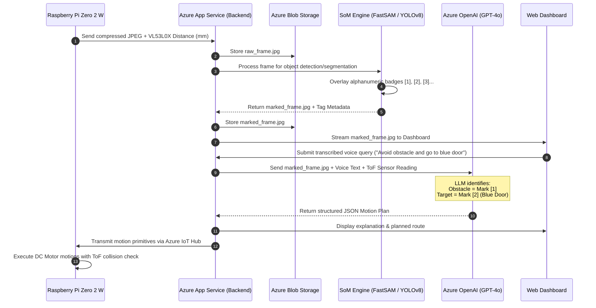

# Cloud-Assisted Natural Language Controlled Wheeled Robot with Voice & Vision Integration
**Final Year Project (FYP2) System Design & Architecture Specification**

---

## 1. System Architecture Diagram & Topology

The system comprises three primary tiers: **Edge Robotics Layer (Raspberry Pi Zero 2 W)**, **Cloud Orchestration & Intelligence Layer (Microsoft Azure)**, and the **User Dashboard & Control Interface**.

```mermaid
flowchart TB
    subgraph User_Interface ["1. User Interaction & Control Layer"]
        User(["👤 User"])
        Mic["🎙️ Voice Input (Web Audio API)"]
        Dash["💻 Web Dashboard (HTML5 / Modern JS / REST & WebSocket)"]
        User -->|Speaks Command| Mic
        Mic -->|Audio Stream| Dash
        Dash -->|View Vision & Telemetry| User
    end

    subgraph Azure_Cloud ["2. Microsoft Azure Cloud Intelligence Layer"]
        AppSvc["🌐 Azure App Service / Container Apps (FastAPI Orchestrator)"]
        SpeechSvc["🗣️ Azure Speech Services (Speech-to-Text & TTS)"]
        BlobStore["🗄️ Azure Blob Storage (Raw & Annotated SoM Frames)"]
        VisionAI["👁️ Object Detector / Segmenter (YOLOv8 / FastSAM)"]
        AOAI["🧠 Azure OpenAI Service (GPT-4o Vision & Reasoning)"]
        IoTHub["📡 Azure IoT Hub (Bidirectional MQTT Broker)"]
        
        Dash <-->|HTTP / WebSockets| AppSvc
        Dash -->|Audio Stream| SpeechSvc
        SpeechSvc -->|Transcribed Text| AppSvc
        
        AppSvc <-->|Store / Retrieve Images| BlobStore
        AppSvc -->|Generate Marks| VisionAI
        VisionAI -->|Overlay Marks| BlobStore
        AppSvc -->|Prompt + SoM Image + Sensor Data| AOAI
        AOAI -->|Structured JSON Motion Plan| AppSvc
        
        AppSvc -->|Dispatch Action Commands (C2D)| IoTHub
        IoTHub -->|Forward Snapshots & Telemetry (D2C)| AppSvc
    end

    subgraph Edge_Robot ["3. Edge Hardware & Embedded Layer (Raspberry Pi Zero 2 W)"]
        PiCore["🖥️ Raspberry Pi Zero 2 W (Python Embedded Agent)"]
        Cam["📷 Pi Camera Module v2 (CSI)"]
        ToF["📏 VL53L0X ToF Distance Sensor (I2C)"]
        L298N["⚡ L298N Dual H-Bridge Motor Driver"]
        Motors["🏎️ 2WD DC Gear Motors + Ball Caster"]
        Power["🔋 2S 18650 Battery Pack + Buck Converter"]

        IoTHub <==>|Secure MQTT (TLS)| PiCore
        Cam -->|Capture CSI Frame| PiCore
        ToF -->|Distance Telemetry (mm)| PiCore
        PiCore -->|GPIO PWM Speed & Direction| L298N
        L298N -->|Drive Current| Motors
        Power -.->|5V Regulated| PiCore
        Power -.->|7.4V Motor VCC| L298N
    end

    subgraph DevOps ["4. Development & Source Control"]
        GitHub["🐙 GitHub Repository"]
        Actions["⚙️ GitHub Actions (CI/CD)"]
        VSCode["💻 VS Code (Remote-SSH / Remote Dev)"]
        
        VSCode -->|Push Code| GitHub
        GitHub --> Actions
        Actions -->|Automated Deploy| AppSvc
    end
```

### Data Flow Lifecycle
1. **Scene Acquisition**: The Raspberry Pi Zero 2 W triggers the Camera Module v2 to snap a scene snapshot upon initialization or command request.
2. **Telemetry Ingestion**: The Pi sends the snapshot along with current VL53L0X distance readings to Azure IoT Hub via lightweight MQTT over TLS.
3. **Voice Command Ingestion**: The user presses a microphone button on the Web Dashboard and speaks (e.g., *"Avoid the obstacle in front and reach the blue door"*).
4. **Speech Transcription**: Azure Speech Services converts speech to natural language text in real-time.
5. **Set-of-Mark (SoM) Tagging**: The cloud orchestrator runs a visual marking pipeline on the frame, overlaying numbered alphanumeric bounding boxes/masks on detected objects.
6. **Multimodal Reasoning (GPT-4o)**: Azure OpenAI receives:
   - The annotated SoM image,
   - The transcribed text prompt,
   - The live VL53L0X distance reading (in mm).
7. **Action Generation**: GPT-4o outputs a structured, deterministic JSON command sequence (e.g., `TURN_RIGHT 30°`, `MOVE_FORWARD 40cm`, `STOP`).
8. **Edge Execution & Reactive Safety Reflex**: The Pi executes the commands via PWM signals to the L298N. Crucially, the local VL53L0X loop acts as an **emergency hardware reflex**: if distance drops below `150mm`, it overrides cloud commands and stops immediately.

---

## 2. Set-of-Mark (SoM) Vision Processing Pipeline

### Why Set-of-Mark (SoM) is Essential for LLM Robotics
Standard Multimodal Large Language Models (MLLMs like GPT-4o) lack fine-grained pixel coordinates awareness. If asked *"go to the blue door on the left"*, the LLM cannot pinpoint exact spatial coordinates directly from raw pixels reliably.

**Set-of-Mark (SoM)** solves this by overlaying unambiguous visual markers (colored bounding boxes, segment masks, and high-contrast numerical badges `[1]`, `[2]`, `[3]`) on every salient object in the scene before feeding it to the LLM.



### Visual Prompting Example
The annotated image will display tags:
- `[1]`: Red Cardboard Box (Obstacle directly ahead)
- `[2]`: Blue Door (Target destination)
- `[3]`: Floor Space / Free Navigation Corridor

### System Prompt Sent to Azure OpenAI (GPT-4o)
```json
{
  "system": "You are a robotic navigation controller. You receive an image annotated with Set-of-Mark (SoM) numerical identifiers, the current front Time-of-Flight (ToF) distance reading in millimeters, and a natural language user command. Your job is to output a deterministic, step-by-step navigation plan in pure JSON.",
  "user_prompt": "Command: 'Avoid the obstacle and reach the blue door'. Front ToF sensor: 240mm.",
  "expected_output_format": {
    "identified_target_mark": 2,
    "identified_obstacles": [1],
    "explanation": "Obstacle [1] is 240mm ahead. Need to divert right into open corridor [3] before turning toward blue door [2].",
    "commands": [
      {"action": "TURN", "direction": "RIGHT", "degrees": 35, "speed_pwm": 180},
      {"action": "FORWARD", "duration_ms": 1200, "speed_pwm": 160},
      {"action": "TURN", "direction": "LEFT", "degrees": 35, "speed_pwm": 180},
      {"action": "FORWARD_UNTIL_TARGET", "target_mark": 2, "speed_pwm": 150}
    ]
  }
}
```

---

## 3. Hardware Interfacing & Electrical Schematic

### Power Distribution Architecture (Critical Engineering Design)
> [!CAUTION]
> **Brownout Prevention**: The Raspberry Pi Zero 2 W draws up to 1.5A–2.0A during Wi-Fi transmission and camera capture. When DC motors start under load, they induce high inrush currents and back-EMF voltage drops.
> **DO NOT** power the Raspberry Pi directly from the L298N onboard 5V regulator. Doing so causes frequent processor resets.

**Solution**: Use a dedicated DC-DC step-down buck converter (e.g., MP1584 or LM2596 module).

```
   [2S 18650 Li-ion Battery Pack (7.4V - 8.4V)]
                      │
                      ├─── [SPST Power Switch]
                      │
        ┌─────────────┴────────────────────────┐
        │                                      │
        ▼ (Raw 7.4V - 8.4V)                   ▼ (Raw 7.4V - 8.4V)
┌───────────────────────┐            ┌─────────────────────────────┐
│  L298N Motor Driver   │            │ High-Efficiency Buck Mod    │
│  Pin: 12V / VCC Input │            │ (MP1584 / LM2596 to 5.0V)   │
└───────────┬───────────┘            └──────────────┬──────────────┘
            │                                       │
            │ (Motor Power)                         ▼ Regulated 5.0V (2A+)
            ▼                                ┌─────────────────────────────┐
   [2x DC Gear Motors]                       │   Raspberry Pi Zero 2 W     │
                                             │   Pins 2, 4 (5V) & 6 (GND)  │
                                             └──────────────┬──────────────┘
                                                            │ (3.3V Logic & CSI)
                                             ┌──────────────┴──────────────┐
                                             ▼                             ▼
                                    [Pi Camera v2]                [VL53L0X ToF]
                                    (CSI Ribbon)                  (I2C: 3.3V, SDA, SCL)

   *IMPORTANT*: L298N GND, Buck Converter GND, and Raspberry Pi GND MUST be interconnected.
```

---

### Complete GPIO Pinout Mapping Table

| Component | Pin / Signal | Raspberry Pi Zero 2 W Physical Pin | BCM / GPIO Number | Function / Description |
| :--- | :--- | :--- | :--- | :--- |
| **Power (Buck)** | 5V Output (+) | Pin 2 or Pin 4 | 5V | Powers the Pi system |
| **Power (Buck)** | Ground (-) | Pin 6 | GND | Common System Ground |
| **L298N** | ENA (Left Motor Speed) | Pin 32 | GPIO 12 (PWM0) | Hardware PWM Speed Control |
| **L298N** | IN1 (Left Motor Fwd) | Pin 11 | GPIO 17 | Direction Logic A |
| **L298N** | IN2 (Left Motor Rev) | Pin 13 | GPIO 27 | Direction Logic B |
| **L298N** | IN3 (Right Motor Fwd)| Pin 15 | GPIO 22 | Direction Logic C |
| **L298N** | IN4 (Right Motor Rev)| Pin 16 | GPIO 23 | Direction Logic D |
| **L298N** | ENB (Right Motor Speed)| Pin 33 | GPIO 13 (PWM1) | Hardware PWM Speed Control |
| **L298N** | GND | Pin 39 (or any GND) | GND | Common reference logic ground |
| **VL53L0X** | VCC | Pin 1 | 3.3V | 3.3V Sensor Logic Power |
| **VL53L0X** | GND | Pin 9 | GND | Ground |
| **VL53L0X** | SDA | Pin 3 | GPIO 2 (I2C1 SDA) | I2C Serial Data line |
| **VL53L0X** | SCL | Pin 5 | GPIO 3 (I2C1 SCL) | I2C Serial Clock line |
| **VL53L0X** | XSHUT | Pin 7 | GPIO 4 | Optional: Software reset / standby |
| **Camera v2** | 15-pin CSI | Dedicated CSI Ribbon Connector | CSI-2 Bus | High-speed MIPI visual data |

---

## 4. Microsoft Azure Cloud Services Breakdown

| Azure Service | Category | Exact Project Role | Why It's Selected |
| :--- | :--- | :--- | :--- |
| **Azure OpenAI Service (GPT-4o)** | Cognitive AI / VLM | Core brain of the robot: parses the SoM-tagged image + transcribed voice command + sensor distance to formulate safe navigation instructions. | Industry-leading multimodal reasoning; generates structured JSON payloads with spatial common sense. |
| **Azure AI Speech** | Cognitive Speech | Real-time Speech-to-Text (STT) for microphone input on the dashboard; optional Text-to-Speech (TTS) for voice confirmation back to the user. | Fast latency, high accuracy with technical / directional vocabulary, multi-language support. |
| **Azure IoT Hub** | IoT / Communications | Secure, bi-directional MQTT message gateway between the Raspberry Pi and the cloud. Ingests telemetry (D2C) and dispatches commands (C2D). | Handles edge reconnection gracefully, TLS security, device digital twins, robust cloud messaging. |
| **Azure Blob Storage** | Storage | Stores raw captured images, processed Set-of-Mark annotated frames, and historical navigation logs. | Cost-effective, high-throughput storage directly addressable via pre-signed SAS URLs. |
| **Azure Container Apps / App Service** | Compute / Backend | Hosts the Python FastAPI backend orchestrator and the Web Dashboard. Runs the SoM marking engine (FastSAM / YOLOv8). | Scalable, containerized deployment with native HTTPS, zero server maintenance, CI/CD integration. |
| **GitHub Actions** | DevOps | Automated testing, linting, and continuous deployment pipeline to Azure Container Apps whenever code is committed in VS Code. | Standard modern engineering workflow for FYP evaluation and reproducible builds. |

---

## 5. Implementation Roadmap (FYP2 Milestones)

1. **Phase 1: Hardware Bench Testing**
   - Assemble 2WD chassis, L298N driver, DC motors, buck converter, and 18650 battery pack.
   - Verify motor forward/reverse/turn PWM functions with `gpiozero` or `RPi.GPIO`.
   - Test VL53L0X distance readings via I2C (`i2cdetect -y 1`).
   - Validate camera captures via `libcamera-still` or `picamera2`.
2. **Phase 2: Azure Cloud Connectivity & Edge Client**
   - Create Azure IoT Hub, Storage Account, and Azure OpenAI instances.
   - Implement Python edge client on Pi Zero 2W using `azure-iot-device` or `paho-mqtt`.
   - Transmit snapshot image + ToF distance reading to Azure Blob Storage / IoT Hub.
3. **Phase 3: Set-of-Mark & Azure OpenAI Orchestration**
   - Deploy backend API (FastAPI) on Azure Container Apps with SoM annotation script.
   - Test multimodal prompt with GPT-4o returning deterministic JSON movement arrays.
4. **Phase 4: Web Dashboard & Voice Control**
   - Build responsive web dashboard with live SoM image viewer and voice capture button (Azure Speech SDK).
   - Integrate end-to-end loop: Voice command -> Speech-to-Text -> SoM reasoning -> IoT Hub command -> Pi movement execution.
5. **Phase 5: Reactive Safety & Edge Optimization**
   - Implement emergency brake thread on Pi Zero 2W reading VL53L0X at 20Hz.
   - Conduct latency profiling, accuracy evaluations, and prepare final thesis report & presentation.
